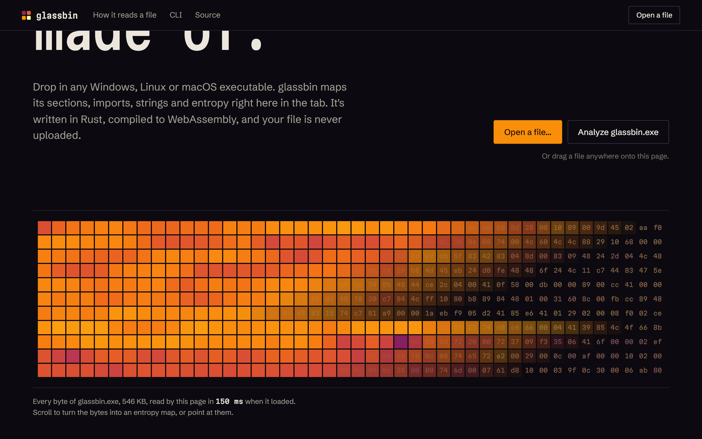
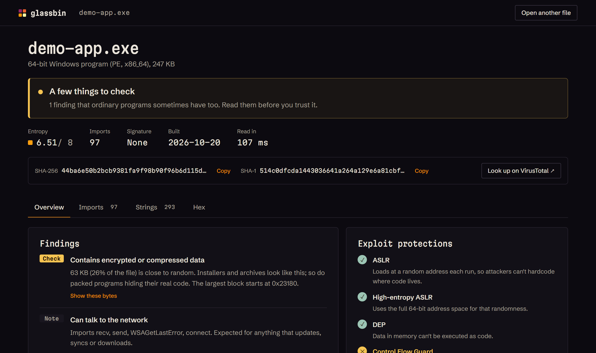

# glassbin

**Know what a program is before you run it.** Drop in a Windows, Linux or macOS executable and glassbin
checks it for packing, hidden data, risky capabilities and missing exploit protections, then gives you
the hashes to look it up. It runs in your browser; the file is never uploaded.

**[Try it →](https://siddharth-droid.github.io/glassbin/)**



## What a report gives you

- **A verdict and findings, in plain language.** Encrypted or compressed regions, known packer
  sections, data appended after the program, a suspiciously short import list, code-injection and
  keylogging capabilities, forged timestamps. Each finding says what it usually means and links to the
  bytes behind it. glassbin never claims a file is safe or malicious, because static analysis can't know.
- **Hashes.** SHA-256 and SHA-1, copyable, with a one-click VirusTotal lookup (only the hash is sent,
  and only when you click).
- **Exploit protections.** ASLR, DEP and Control Flow Guard for Windows; PIE, NX stack, full RELRO
  and stack canaries for Linux; PIE for macOS. Plus Authenticode signature presence and .NET detection.
- **Map of the file.** An entropy heatmap and section layout. Click any cell to open its bytes.
- **Imports, strings and hex.** Capabilities inferred from imports; every readable string, filterable;
  and a virtualized hex view with go-to-offset that handles large files.



The page ships two samples built from this repo: `samples/demo-app` (harmless, but built to trip the
checks: an embedded random blob, network imports, a URL) and glassbin's own CLI.

## How it works

All analysis lives in one Rust library, **`glassbin-core`**. Everything else is a thin shell around it:

```
crates/core   parsing (PE, ELF, Mach-O via goblin), entropy, string extraction; no I/O
crates/wasm   wasm-bindgen wrapper; the web app runs it in a Web Worker
crates/cli    the `glassbin` command-line tool
samples/      demo-app, the landing page's "suspicious" sample
web/          React front end (Vite): WebGL heatmap, TanStack Virtual for strings and hex
```

The browser build copies the file into the WebAssembly module's memory and nowhere else. The landing
page shows its own network requests, read live from the browser, so you can check that claim.

### Built to take hostile input

Malware is often deliberately malformed to crash the tools that inspect it. glassbin is written in
memory-safe Rust, and:

- `crates/core/tests/hostile_input.rs` corrupts a real executable thousands of ways (header damage,
  random damage, truncation) and requires the pipeline to survive every one.
- `fuzz/` holds a [cargo-fuzz](https://github.com/rust-fuzz/cargo-fuzz) target for coverage-guided
  fuzzing, which CI runs weekly.
- In the browser, analysis runs in a Web Worker with a size limit and a timeout. If the engine ever
  fails, the worker is discarded and a fresh one takes its place.

## Run it locally

You need [Rust](https://rustup.rs), [wasm-pack](https://rustwasm.github.io/wasm-pack/) and Node 20+.

```sh
# the CLI
cargo run --release -p glassbin -- path/to/program.exe

# the web app
cd web
npm install
npm run wasm     # compile the Rust engine to WebAssembly
npm run sample   # build the two sample programs the landing page offers
npm run dev
```

Tests: `cargo test` (Rust) and `npm run build` (types and bundle). Fuzzing: `cargo +nightly fuzz run parse`
from the repository root, on Linux or macOS.

## Limitations

- Universal (fat) Mach-O files aren't parsed yet; entropy and strings still work on them.
- String extraction is ASCII-only, and its noise filter is a heuristic.
- Files up to 256 MB in the browser.

## Licence

MIT. See [LICENSE](LICENSE).
